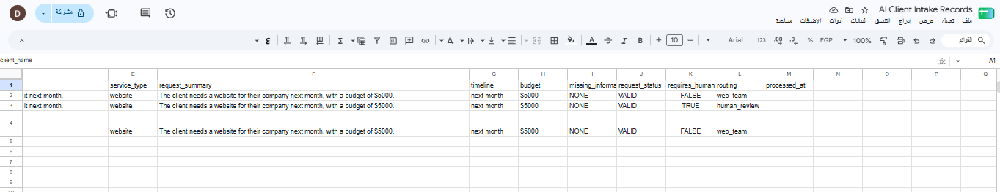
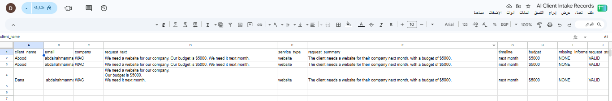
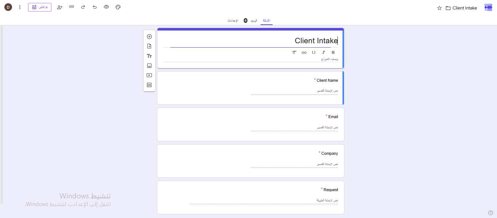

# AI Client Intake & Request Routing System

> An automation that receives client requests from a form, uses AI to extract structured information, applies clear rules to route each request, and sends incomplete requests to a human for review.

---

## 🎯 Problem

### The Context
A service company receives requests from potential clients. Each request has to be read, understood, organized and checked before the team decides what to do next.

### The Problem
Requests are handled manually. An employee reads each one, extracts the key details, checks whether the information is complete and decides the next step. As the number of requests grows, this takes more time and important details can be missed or delayed.

### Why It Matters
Faster, more consistent handling means ready requests reach the right team quickly, and unclear ones are not passed on by mistake.

---

## 💡 Solution

An automation built with **Google Forms, Zapier, AI by Zapier, Google Sheets and Gmail**. It reads the client's free-text request, turns it into structured fields, decides the route with fixed rules, records the result and notifies the right person.

**What does the system do?**

- Receives a new client request from Google Forms.
- Uses AI to extract the service type, timeline and budget, and to summarize the request.
- Marks the request `VALID` or `NEEDS_REVIEW` and routes it.
- Saves the result in Google Sheets and sends an email to the matching person.

---

## 👤 Users

**Primary Users:**
The service company's team that receives client requests, and the staff member who reviews incomplete ones.

**User Need:**
Receive organized requests, know which ones are ready to proceed, and be alerted to the ones that need a human decision.

---

## 🧠 How I Designed the Solution

I followed the U1 engineering flow: **Understand → Decompose → Understand the data → Design the decision → Handle exceptions → Design the automation → Build → Test.**

The main idea is a clear split of responsibility:

```text
AI → Understand     Rules → Control     Human → Judge
```

The design was written before any tool was opened (business analysis, workflow decomposition, data design, decision and exception design).

---

## ⚙️ How It Works

```text
Client submits Google Form
  ↓
Zapier trigger: New Form Response
  ↓
AI by Zapier extracts structured data
  ↓
Paths by request_status
  ├─ VALID → Google Sheets row (requires_human = false, routing = web_team) → Email to team
  └─ Fallback → Google Sheets row (requires_human = true, routing = human_review) → Email for human review
```

---

## 🤖 Role of AI

**What does AI do in this solution?**

- Extracts `service_type`, `timeline` and `budget` from the free-text request.
- Writes a short `request_summary`.
- Lists what is missing or unclear in `missing_information`.

**What AI Should NOT Do**

- Invent, assume or guess information the client did not state (for example, turning "soon" into a date).
- Take the final decision on the operational process. The routing follows fixed, testable rules.

---

## 🔄 Automation

**What parts of the process are automated?**

- Receiving the request and starting the workflow.
- Extracting and structuring the information.
- Deciding the route (`VALID` or `NEEDS_REVIEW`).
- Recording the result in Google Sheets.
- Sending the notification email.

**What stays human:** reviewing requests with missing or unclear information.

---

## 🗂️ Data

**Input**
`client_name`, `email`, `company`, and `request_text` (unstructured free text).

**Output**
`service_type`, `request_summary`, `timeline`, `budget`, `missing_information`, `request_status`, `requires_human`, `routing`, saved as one row per request in Google Sheets.

---

## 🛠️ Tools & Technologies

| Tool | Purpose |
|---|---|
| Google Forms | Client intake form (the trigger and input) |
| Zapier | Workflow automation and Paths routing |
| AI by Zapier | Extracting structured data from the free-text request |
| Google Sheets | Recording the request and processing results |
| Gmail | Notifying the team or the reviewer |

---

## 🔑 Key Design Decisions

### Decision 1
**Decision:** The AI returns a clear `request_status` (`VALID` or `NEEDS_REVIEW`) and the Paths read only that value.

**Why:** A single clear signal makes the logic simpler, easier to test and easier to debug than interpreting several fields inside the Path.

### Decision 2
**Decision:** Use Paths with a Fallback instead of a Filter.

**Why:** The goal is not to stop problematic requests but to route them to a human, so no exception disappears.

### Decision 3
**Decision:** The AI prompt uses only information the client explicitly stated, and vague timeframes become `null`.

**Why:** Garbage in means garbage out. A guessed value would let an incomplete request pass as valid.

---

## 🧪 Testing

### Test 1: Complete request
**Input:**
```text
We need a website for our company. Our budget is $5000. We need it next month.
```
**Expected Result:** `service_type = website`, `timeline = next month`, `budget = $5000`, `missing_information = NONE`, `request_status = VALID`, routed to the Valid path (`requires_human = false`, `routing = web_team`).

**Actual Result:** Matched the expected result.

**Status:** ✅

### Test 2: Missing budget
**Input:**
```text
We need a website for our company. We need it next month.
```
**Expected Result:** `budget = null`, `missing_information = budget`, `request_status = NEEDS_REVIEW`, routed to Human Review.

**Actual Result:** Matched the expected result.

**Status:** ✅

### Test 3: Ambiguous timeline
**Input:**
```text
We need a website soon. Our budget is $5000.
```
**Expected Result:** `timeline = null`, `missing_information = timeline`, `request_status = NEEDS_REVIEW`, routed to Human Review.

**Actual Result:** Matched the expected result.

**Status:** ✅

### Test 4: Multiple missing fields
**Input:**
```text
We need a website for our company.
```
**Expected Result:** `timeline = null`, `budget = null`, `missing_information = timeline, budget`, `request_status = NEEDS_REVIEW`, routed to Human Review.

**Actual Result:** Matched the expected result.

**Status:** ✅

---

## 📸 Evidence

### Final Result




### Workflow


### Client Intake Form


---

## ⚠️ Challenges & Failures

**What didn't work as expected?**

- The AI could treat a vague phrase such as "soon" as a usable timeline, which would let an incomplete request pass as `VALID`.
- After the Zapier plan changed, the Zap could no longer be re-run to capture screenshots for every test.

**How did I solve it?**

- I added explicit rules to the prompt: use only stated information, and return `null` for vague timeframes.
- I documented each test with its input and expected result.

---

## 📚 What I Learned

### Technical Lesson
How to connect a trigger, an AI step, Paths, a spreadsheet and email into one workflow, and how to debug it layer by layer.

### Problem-Solving Lesson
Understand and design the work before choosing a tool. Tools implement the design; they do not replace it.

### AI Lesson
AI is strong at understanding free text, but the decisions that control the process should be clear rules, with a human reviewing unclear cases.

---

## 🔮 Future Improvements

If I continued developing this project, I would:

- Fill the `processed_at` timestamp automatically for every request.
- Send the client an automatic acknowledgment email.
- Add more service categories and a dashboard over the Google Sheet.

---

## 🔗 Project Links

**Live Demo:** [Client Intake Form](https://forms.gle/mPdSKjPqZnUkTpdv9)

**Workflow:** [Zap flow screenshot](Screenshots/02-zap-flow.png)

**Repository:** [Portfolio_Template](https://github.com/danaabuhassira/Portfolio_Template)

**Records:** [AI Client Intake Records (Google Sheet)](https://docs.google.com/spreadsheets/d/1iHJD1KNM2HwR3Yxv2vyHTezoMcOK49ELLW6yZSc0UME/edit?usp=sharing)

---

## 👩‍💻 Author

**Dana Abu Hasira**

[LinkedIn] · [GitHub](https://github.com/danaabuhassira)
