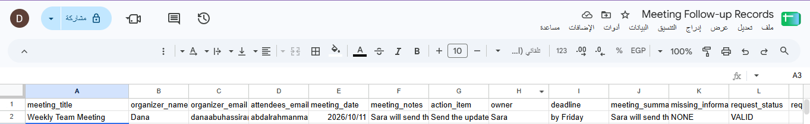
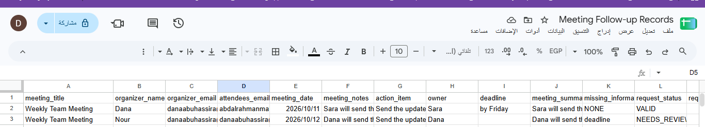
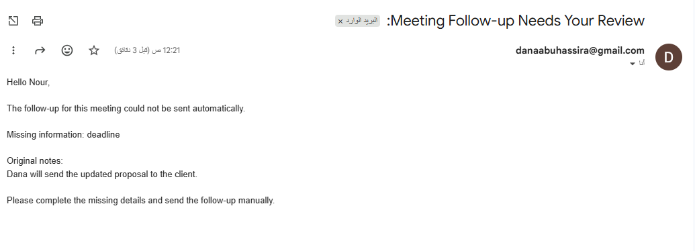

# Meeting Follow-up Automation

> An automation that turns free-text meeting notes into a structured record, sends the follow-up when the task, owner and deadline are clear, and asks the organizer to complete anything missing.

---

## 🎯 Problem

### The Context
After a meeting, notes are usually written freely on paper, WhatsApp or a file. Someone then reads them and sends follow-up messages by hand.

### The Problem
Notes often miss who is responsible for a task or when it is due. These gaps are discovered late, or never, so tasks get lost or delayed.

### Why It Matters
Clear owners and deadlines are what turn a meeting into action. Sending an inaccurate follow-up is worse than sending none, so incomplete notes must be caught before anything is sent.

---

## 💡 Solution

An automation built with **Google Forms, Zapier, AI by Zapier, Google Sheets and Gmail**.

**What does the system do?**

- Receives meeting notes from a Google Form.
- Uses AI to extract the action item, the owner and the deadline, and to write a short summary.
- Marks the notes `VALID` or `NEEDS_REVIEW`.
- Records every meeting in Google Sheets.
- Sends the follow-up to the attendees when the notes are complete, or a review request to the organizer when something is missing.

---

## 👤 Users

**Primary Users:**
Meeting organizers who submit notes, and the attendees who receive the follow-up.

**User Need:**
Get a clear, accurate follow-up after each meeting, without checking every set of notes by hand.

---

## 🧠 How I Designed the Solution

I designed the workflow before building it, following the U1 flow: understand the work, decompose it, understand the data, design the decision, handle exceptions, then build and test.

The main decisions:

- AI reads and extracts. Fixed rules decide the route. A human handles what is incomplete.
- The AI returns a single `request_status`, so the Paths read one clear signal.
- Incomplete notes are routed to the organizer, not dropped.

---

## ⚙️ How It Works

```text
Google Form (meeting notes)
  ↓
Trigger: New Form Response
  ↓
AI by Zapier extracts action_item, owner, deadline, summary, status
  ↓
Paths by request_status
  ├─ VALID → Sheet row (requires_human = false, routing = send_followup) → Email to attendees
  └─ Fallback → Sheet row (requires_human = true, routing = human_review) → Email to organizer
```

---

## 🤖 Role of AI

**What does AI do in this solution?**

- Extracts the main `action_item`, the `owner` and the `deadline` from the notes.
- Writes a short `meeting_summary`.
- Lists what is missing in `missing_information` and returns `request_status`.

**What AI Should NOT Do**

- Guess or invent an owner or a deadline.
- Accept "we", "the team" or "someone" as an owner.
- Turn a vague deadline such as "soon" or "as soon as possible" into a specific one.

---

## 🔄 Automation

**What parts of the process are automated?**

- Capturing each new form response.
- Extracting and structuring the information.
- Choosing the route.
- Recording the meeting in Google Sheets.
- Sending the follow-up or the review email.

**What stays human:** completing missing details and sending the follow-up manually when the notes are incomplete.

---

## 🗂️ Data

**Input**
Meeting title, organizer name and email, attendees' emails, meeting date, and meeting notes (free text).

**Output**
`action_item`, `owner`, `deadline`, `meeting_summary`, `missing_information`, `request_status`, `requires_human`, `routing`, `processed_at`, saved as one row per meeting in a 15-column sheet.

---

## 🛠️ Tools & Technologies

| Tool | Purpose |
|---|---|
| Google Forms | Collecting the meeting notes (trigger and input) |
| Zapier | Workflow automation |
| AI by Zapier | Extracting structured data from free text |
| Paths by Zapier | Routing by `request_status` with a Fallback |
| Google Sheets | Recording each meeting and its result |
| Gmail | Follow-up email and review email |

---

## 🔑 Key Design Decisions

### Decision 1
**Decision:** Required and unclear fields are never guessed. The AI leaves them empty and lists them in `missing_information`.

**Why:** A guessed owner or deadline would send a wrong follow-up that looks correct.

### Decision 2
**Decision:** Paths with a Fallback, instead of stopping on incomplete notes.

**Why:** The goal is to route the exception to the organizer so nothing disappears.

### Decision 3
**Decision:** Turn off the `Required` option on the AI output fields.

**Why:** A required field pushes the AI to fill a value even when the notes do not contain it.

---

## 🧪 Testing

### Test 1: Complete notes
**Input:** `Sara will send the updated proposal to the client by Friday.`

**Expected Result:** `VALID`, `missing_information = NONE`.

**Actual Result:** `VALID`, `missing_information = NONE`.

**Status:** ✅

### Test 2: Missing deadline
**Input:** `Sara will send the updated proposal to the client.`

**Expected Result:** `NEEDS_REVIEW`, deadline missing.

**Actual Result:** `NEEDS_REVIEW`, deadline missing, review email sent to the organizer.

**Status:** ✅

### Test 3: Missing owner
**Input:** `The updated proposal must be sent to the client by Friday.`

**Expected Result:** `NEEDS_REVIEW`, owner missing.

**Actual Result:** `NEEDS_REVIEW`, owner missing.

**Status:** ✅

### Test 4: Vague deadline
**Input:** `Sara will send the proposal as soon as possible.`

**Expected Result:** `NEEDS_REVIEW`, deadline missing.

**Actual Result:** `NEEDS_REVIEW`. "As soon as possible" was not treated as a deadline.

**Status:** ✅

### Test 5: No clear task
**Input:** `We discussed the project budget.`

**Expected Result:** `NEEDS_REVIEW`, task, owner and deadline missing.

**Actual Result:** `NEEDS_REVIEW`, task, owner and deadline missing.

**Status:** ✅

---

## 📸 Evidence

### Final Result

**Test 1 (complete notes) in the sheet**



**Test 2 (missing deadline) in the sheet**



**Review email sent to the organizer**



### Workflow


---

## ⚠️ Challenges & Failures

**What didn't work as expected?**

- In the Fallback path I chose the Google Sheets action `Clear Spreadsheet Row(s)` instead of `Create Spreadsheet Row`.
- I designed missing values to return `NOT_PROVIDED`, but in practice they appear empty in the sheet.
- `missing_information` appeared empty in some tests after I turned off `Required`.
- I could not find `Zap Meta` for the processing time.

**How did I solve it?**

- I noticed the extra `Row(s)` field, went back to Setup and changed the action to `Create Spreadsheet Row`.
- The empty values are still open. They do not affect routing because `missing_information` and `request_status` carry the decision. A later fix is a step that converts empty values to `NOT_PROVIDED`.
- I adjusted the `Output Fields` settings and re-tested.
- I used the trigger's `Create Time` field instead, recorded in UTC.

---

## 📚 What I Learned

### Technical Lesson
Choosing the exact action matters. A wrong Google Sheets event looks like a data problem but is a setup problem.

### Problem-Solving Lesson
Test each case, write down what is still unsolved, and separate what works from what still needs improvement.

### AI Lesson
AI is useful for extracting information from free text, but it must be told not to guess, and the routing should follow clear rules.

---

## 🔮 Future Improvements

If I continued developing this project, I would:

- Convert empty values to `NOT_PROVIDED` so missing fields are explicit.
- Add the original organizer's name and the missing field names to the review email as a checklist.
- Support several action items in one set of notes.

---

## 🔗 Project Links

**Live Demo:** [Meeting Follow-up Form](https://forms.gle/2kLSZj3ZvfAJ6AAZ6) (the automation depends on an active Zapier plan)

**Workflow:** [Zap flow screenshot](Screenshots/01-zap-flow.png)

**Repository:** [Portfolio_Template](https://github.com/danaabuhassira/Portfolio_Template)

**Records:** [Meeting Follow-up Records (Google Sheet)](https://docs.google.com/spreadsheets/d/1aN6CBIR3JCemOshwFxCPm51Av_Dl1n54R1WqvoJMIL4/edit?usp=sharing)

---

## 👩‍💻 Author

**Dana Abu Hasira**

[LinkedIn] · [GitHub](https://github.com/danaabuhassira)
