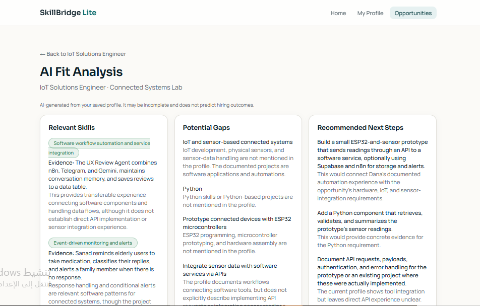
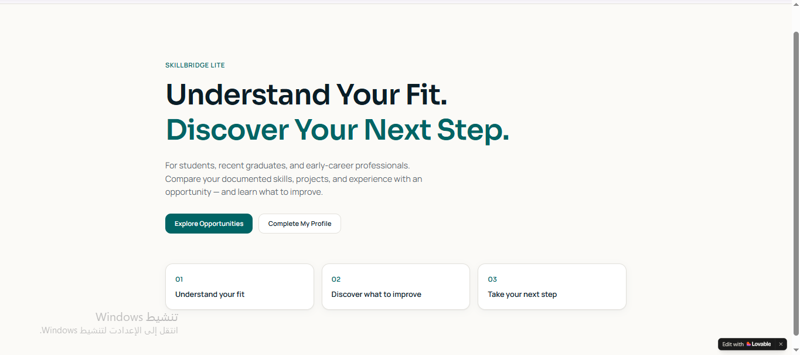
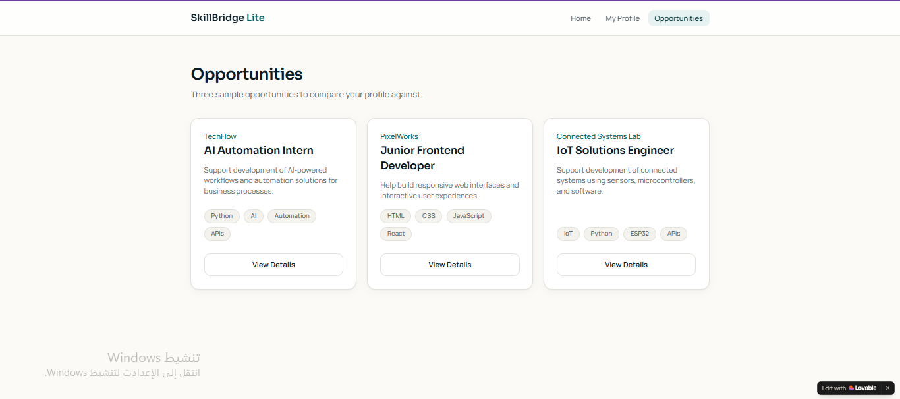
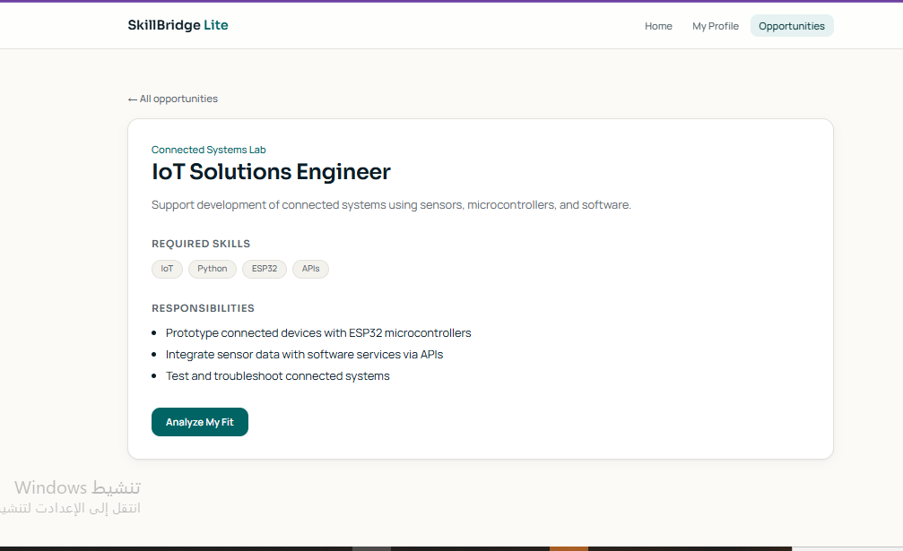

# SkillBridge Lite

> A web app that compares a user's professional profile with a selected opportunity and shows relevant skills, potential gaps and recommended next steps.

---

## 🎯 Problem

### The Context
Students, recent graduates and early-career professionals often have skills, projects and some experience, and want to apply for an internship or a job.

### The Problem
They find it hard to connect their documented skills and projects to the requirements of a specific opportunity. It is unclear which skills are relevant, which requirements need more evidence or learning, and what to do next.

### Why It Matters
A clearer view of the link between a profile and an opportunity helps the user decide what to learn or document next, instead of guessing.

---

## 💡 Solution

**SkillBridge Lite** lets the user keep a professional profile, browse sample opportunities, and request an AI analysis of how the profile relates to one selected opportunity.

**What does the system do?**

- Shows and lets the user edit a professional profile (skills, projects, experience).
- Lists three sample opportunities with their requirements and responsibilities.
- Opens the details of the selected opportunity.
- Runs **Analyze My Fit** using the saved profile and the selected opportunity.
- Displays three result sections: **Relevant Skills**, **Potential Gaps** and **Recommended Next Steps**.

---

## 👤 Users

**Primary Users:**
Students, recent graduates and early-career professionals.

**User Need:**
Understand how their current profile relates to a specific opportunity and what to do to prepare. The app is designed for a single user in this version.

---

## 🧠 How I Designed the Solution

I followed the five U2 layers before building: **Understand the User → Define the Solution → Design the Experience → Design the System → Specify & Build with AI.**

Main decisions:

- **Small MVP.** Five features only: profile, opportunities, opportunity details, analyze, results. No authentication, database, admin dashboard, job search or applications.
- **Honest AI.** The analysis must use only the supplied profile and opportunity, must not invent skills, and must separate "no evidence in the profile" from "confirmed lack of skill".
- **Build in small steps.** One clear prompt per stage, then review, instead of asking the tool to build everything at once.

---

## ⚙️ How It Works

```text
Home
  ↓
My Profile (view / edit)  ·  Opportunities (3 samples)
  ↓
Opportunity Details
  ↓
Analyze My Fit  ← saved profile + selected opportunity
  ↓
AI Fit Analysis
  ├─ Relevant Skills
  ├─ Potential Gaps
  └─ Recommended Next Steps
```

---

## 🤖 Role of AI

**What does AI do in this solution?**

- Compares the profile (skills, projects, experience) with the selected opportunity's requirements.
- Returns structured feedback: relevant skills with evidence, potential gaps with a reason, and recommended next steps with a reason.

**What AI Should NOT Do**

- Invent skills, projects or experience that are not in the profile.
- Treat missing information as proof that a skill is missing.
- Predict or guarantee hiring outcomes. The result page states that the analysis may be incomplete and does not predict hiring outcomes.

---

## 🔄 Automation

**What parts of the process are automated?**

- Using the selected opportunity and the saved profile as the input of the analysis.
- Producing and displaying the structured analysis after the user presses **Analyze My Fit**.

**What stays human:** the user decides how to use the feedback and what to learn or build next.

---

## 🗂️ Data

**Input**
- Profile: name, headline, about, skills, projects, experience.
- Opportunity: title, company, description, required skills, responsibilities (three fixed samples).

**Output**
- `relevantSkills` (item, evidence, relevance)
- `potentialGaps` (requirement, reason)
- `recommendedNextSteps` (action, reason)

---

## 🛠️ Tools & Technologies

| Tool | Purpose |
|---|---|
| Lovable | Building the web app from a written specification |
| AI analysis service | Generating the structured fit analysis |
| GitHub | Documenting the design files and this README |

---

## 🔑 Key Design Decisions

### Decision 1
**Decision:** Limit the first version to five features and three fixed sample opportunities.

**Why:** A small scope keeps the build realistic for the session and the available credits, and keeps focus on the core flow.

### Decision 2
**Decision:** Treat the AI result as supported by the supplied profile only, and show a disclaimer on the results page.

**Why:** An unmentioned skill is not proof of a missing skill, and the tool should never promise hiring outcomes.

### Decision 3
**Decision:** Fix issues with small, targeted prompts instead of rebuilding the app.

**Why:** It protects what already works and avoids wasting credits.

---

## 🧪 Testing

### Test 1: Opportunity details
**Input:** Open **Opportunities** and select *IoT Solutions Engineer*.

**Expected Result:** The details page shows this opportunity's company, required skills (IoT, Python, ESP32, APIs) and responsibilities.

**Actual Result:** The page showed Connected Systems Lab, the four required skills and the three responsibilities of this opportunity.

**Status:** ✅

### Test 2: AI Fit Analysis
**Input:** Press **Analyze My Fit** on the IoT Solutions Engineer opportunity.

**Expected Result:** The results page shows Relevant Skills, Potential Gaps and Recommended Next Steps based on the saved profile and this opportunity, with a note that it is AI-generated and does not predict hiring outcomes.

**Actual Result:** The three sections appeared. Relevant skills cite evidence from the profile's projects, the gaps relate to the opportunity's requirements (IoT, Python, ESP32, API integration), and the next steps are tied to those gaps.

**Status:** ✅

---

## 📸 Evidence

### Final Result



### Workflow







---

## 📚 What I Learned

### Technical Lesson
How to turn a written specification into a working web app with an AI app builder, then review it against the design.

### Problem-Solving Lesson
Define the smallest useful version first, and fix specific issues instead of rebuilding everything.

### AI Lesson
A page that shows results does not prove a real AI analysis happened. The output has to be checked against the input and the rules.

---

## 🔮 Future Improvements

If I continued developing this project, I would:

- Improve how long skill labels wrap on the results cards.
- Allow the user to paste a real opportunity description instead of using only three samples.
- Add accounts so a profile can follow the user across devices.

---

## 🔗 Project Links

**Live Demo:** [SkillBridge Lite](https://job-ai-fit.lovable.app)

**Workflow:** [Design files in this folder](./)

**Repository:** [Portfolio_Template](https://github.com/danaabuhassira/Portfolio_Template)

---

## 👩‍💻 Author

**Dana Abu Hasira**

[GitHub](https://github.com/danaabuhassira)
