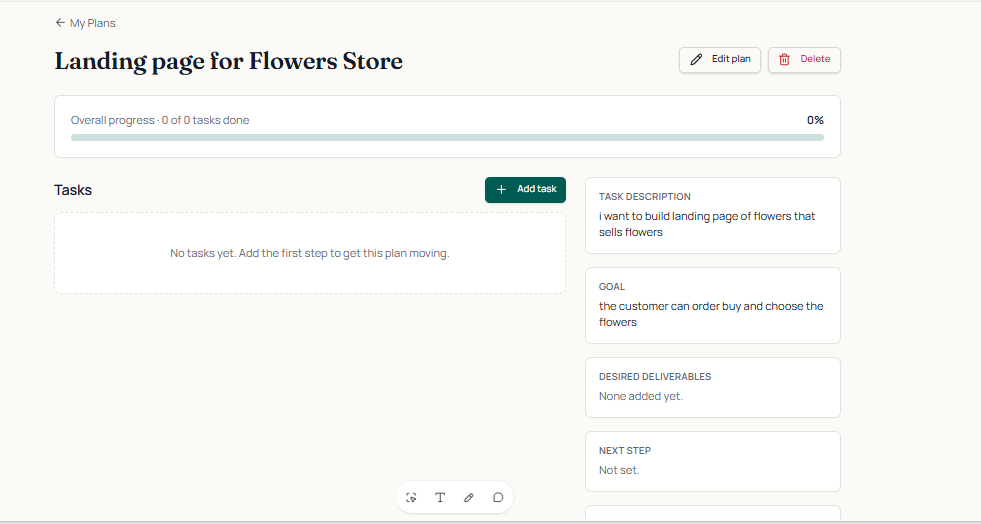
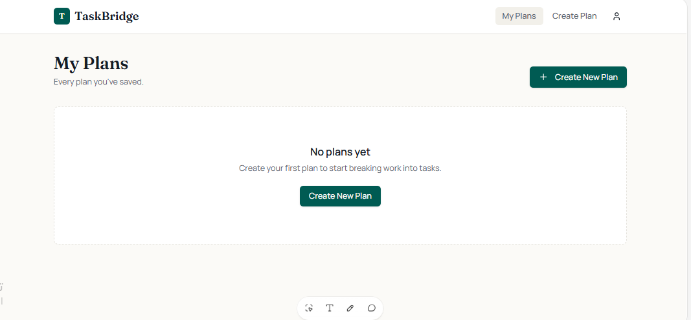
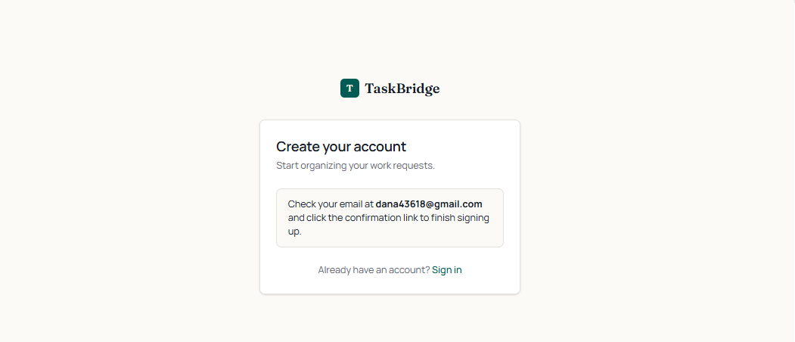
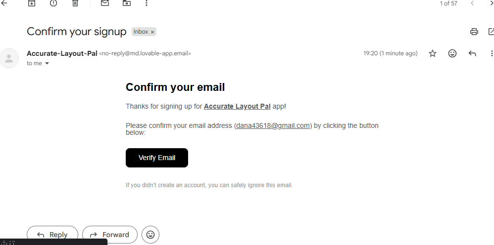

# TaskBridge

> A web app that turns unclear work requests into organized plans with tasks, priorities, statuses and a progress bar, using Supabase for sign-in and data storage.

---

## 🎯 Problem

### The Context
Freelancers and early-career professionals often receive work requests that are not clearly defined.

### The Problem
Without a plan, it is hard to know what the outcome should be, which tasks are needed, what to start with, what is already done, and what comes next.

### Why It Matters
A clear plan with tasks, priorities and progress makes the work easier to organize and follow through.

---

## 💡 Solution

**TaskBridge** gives each user a private space to turn a goal into a plan, break it into tasks, and follow the progress.

**What does the system do?**

- Lets a user create an account and sign in (with email confirmation).
- Lets a user create plans with a title, description, goal and optional deadline.
- Shows each plan with its tasks, desired deliverables, next step and overall progress.
- Calculates progress from completed tasks, and shows 0% when a plan has no tasks.

---

## 👤 Users

**Primary Users:**
Freelancers, recent graduates and early-career professionals working on their own.

**User Need:**
Turn a request or a goal into clear steps and see how far the work has progressed. This first version is for individual use, not team collaboration.

---

## 🧠 How I Designed the Solution

The design follows one chain: **Goal → Plan → Tasks → Priorities → Status → Progress.**

Main decisions:

- **Real storage, not mock data.** Plans and tasks are designed to live in a Supabase database.
- **Two related tables.** A `plans` table and a `plan_tasks` table, where every task belongs to one plan and one user.
- **Security in the database.** The design specifies Row Level Security so each user can reach only their own data, instead of relying on hiding things in the interface.
- **Small MVP.** No AI generation, teams, payments or notifications in this version.

---

## ⚙️ How It Works

```text
Create account → confirm email → sign in
  ↓
My Plans
  ↓
Create Plan (title, description, goal, deadline)
  ↓
Plan Details (tasks, deliverables, next step, progress)
```

---

## 🗂️ Data

**Input**
Plan title, task description, desired outcome (goal), optional deadline, and tasks with a priority (`High`, `Medium`, `Low`) and a status (`To Do`, `In Progress`, `Done`).

**Output**
A list of the user's plans and, for each plan, its tasks and a progress percentage calculated as `completed tasks ÷ total tasks × 100`.

---

## 🛠️ Tools & Technologies

| Tool | Purpose |
|---|---|
| Lovable | Building the application with an AI app builder |
| Supabase Auth | Sign-up, email confirmation and sign-in |
| Supabase PostgreSQL | Storing plans and tasks |
| GitHub | Documenting the project |

---

## 🔑 Key Design Decisions

### Decision 1
**Decision:** Calculate progress from the current task statuses instead of storing a typed-in percentage.

**Why:** A stored number could drift away from the real task data.

### Decision 2
**Decision:** Link each task to its plan and owner together.

**Why:** It prevents a task from being attached to a plan that belongs to another user.

### Decision 3
**Decision:** Keep AI plan generation out of the first version.

**Why:** The goal was to prove the core system (accounts, data and progress) before adding more features.

---

## 🧪 Testing

### Test 1: Sign up with email confirmation
**Input:** Create an account with a valid email address.

**Expected Result:** The app asks the user to confirm the email, and a confirmation email arrives.

**Actual Result:** The app showed a message asking to check the email and click the confirmation link, and a "Confirm your signup" email arrived.

**Status:** ✅

### Test 2: Access after confirmation
**Input:** Confirm the email and open the app.

**Expected Result:** The user reaches the **My Plans** page, and a new account with no plans sees an empty state.

**Actual Result:** My Plans opened and showed "No plans yet" with a button to create the first plan.

**Status:** ✅

### Test 3: Create a plan and view its details
**Input:** Create a plan titled "Landing page for Flowers Store" with a description and a goal.

**Expected Result:** The plan details page shows the title, description and goal, and shows 0% progress because the plan has no tasks yet.

**Actual Result:** The details page showed the title, description and goal, and "Overall progress · 0 of 0 tasks done, 0%".

**Status:** ✅

---

## 📸 Evidence

### Final Result





### Workflow





---

## ⚠️ Challenges & Failures

**What didn't work as expected?**

- While testing, the app returned an **HTTP 521** error.
- Sign-up rejected an email address with an error saying the address was not allowed, because it used an invalid or reserved domain.

**How did I solve it?**

- The Supabase project was still starting ("Coming up…") when the error appeared. After the project finished starting, the app worked.
- I signed up again with a real email address and confirmed it from the email I received.

---

## 📚 What I Learned

### Technical Lesson
Sign-in, a database and the interface are separate parts, and a problem in one (like a database that is still starting) shows up as an error in the app.

### Problem-Solving Lesson
Read the exact error message and find which layer it comes from before changing anything.

### AI Lesson
An AI builder can create the screens quickly, but the design of the data and the access rules still has to be specified and checked.

---

## 🔮 Future Improvements

If I continued developing this project, I would:

- Test adding, editing and deleting tasks, and changing their priority and status.
- Test that plans and tasks stay saved after refreshing and after signing out and in again.
- Test with two different accounts to confirm users cannot see each other's data.
- Add AI plan generation and evaluation later.

---

## 🔗 Project Links

**Repository:** [Portfolio_Template](https://github.com/danaabuhassira/Portfolio_Template)

---

## 👩‍💻 Author

**Dana Abu Hassira**

[GitHub](https://github.com/danaabuhassira)
