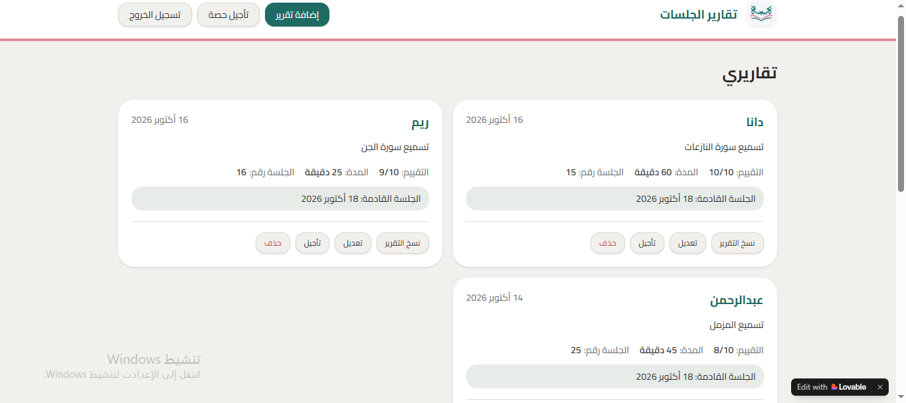
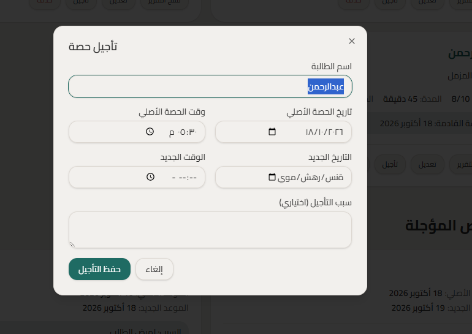
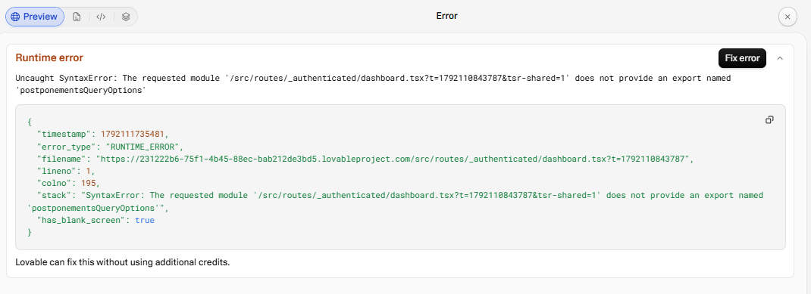
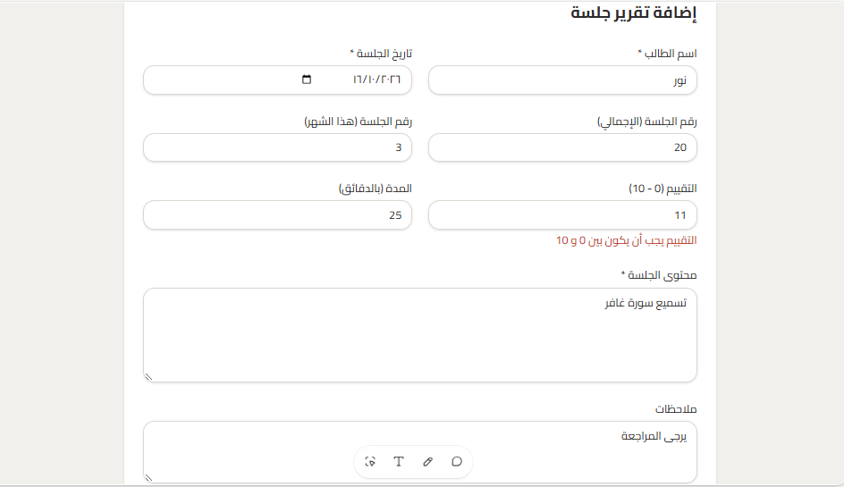
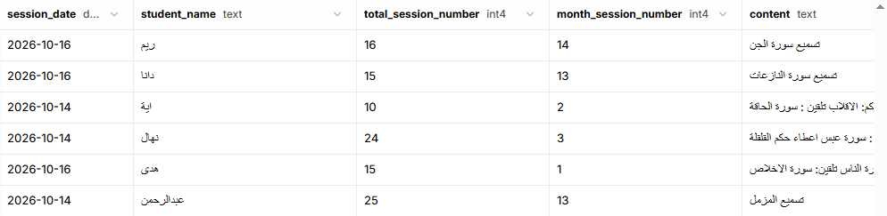

# Student Session Tracker

> A private web dashboard where a teacher records each student's lesson report, copies it as a ready-to-send message in a fixed Arabic template, and handles postponed lessons without double-booking a slot.

---

## 🎯 Problem

### The Context
I teach students one-to-one at an online academy. After every lesson I send each student a written report on WhatsApp, in a fixed Arabic template (date, student name, lesson number, content, rating out of 10, duration, homework, and the next lesson's day and time).

### The Problem
I was rewriting this template by hand after every lesson, and again for every postponement. This was slow, and small mistakes crept in: a wrong date, a forgotten field, or two lessons booked at the same day and time.

### Why It Matters
A consistent, correct report builds trust with students and keeps the schedule reliable. Saving the time spent retyping the same message also leaves more time for teaching.

---

## 💡 Solution

I built a small web app (Lovable + Supabase) where I enter each lesson report once, and the app turns it into the exact message I send.

**What does the system do?**

- Stores lesson reports (one card per report) in my own Supabase database.
- Generates the report text in my fixed Arabic template with one click (copy button), with no empty values and times in 12-hour format (صباحًا / مساءً).
- Lets me edit or delete a report.
- Handles postponed lessons through a "تأجيل" (postpone) form that saves into a dedicated postponements table, and generates a postponement message in a second fixed template.
- Blocks two lessons at the same day and time.

---

## 👤 Users

**Primary Users:**
One user: the teacher (me), signed in with a Supabase login.

**User Need:**
Record a lesson report in less than a minute, send a correct message to the student, and reschedule a lesson without creating a time conflict.

---

## 🧠 How I Designed the Solution

I kept the system small on purpose: **one user and a few tables**, so that I could focus on testing and proving it works rather than managing complexity. I used my own report template as the data model, so every field in the database matches a line in the message I already send. I also decided that important rules, such as blocking a double-booked slot, should live in the database and not only in the interface.

---

## ⚙️ How It Works

```
Teacher signs in
  ↓
Fills the report form (or the postpone form)
  ↓
Validation + database rule (no two lessons at the same day/time)
  ↓
Saved in Supabase → shown as a card on the dashboard
  ↓
"Copy report" / "Copy postponement report"
  ↓
Ready-to-send Arabic message
```

---

## 🤖 Role of AI

**What does AI do in this solution?**

- Lovable's AI builder generated the app (screens, forms, and database connections) from step-by-step prompts that I wrote.
- I used Claude to help me plan the project, write small and focused prompts, and review the results.
- Each prompt was limited to one change, with an explicit instruction not to touch anything else.

**What AI Should NOT Do**

- Create new tables, run migrations, or change my existing database structure without my approval.
- Change parts of the app that I did not ask it to change.
- Decide the content of a report (the lesson content, rating, and homework are always entered by me).

---

## 🔄 Automation

- Turning a saved report into the formatted Arabic message (including date style and 12-hour time).
- Turning a saved postponement into its own formatted message.
- Blocking a double-booked day and time automatically at the database level.
- Showing the upcoming lesson on each report card.

---

## 🗂️ Data

**Input**
Report fields: date, student name, teacher name, lesson number, lesson content, rating (out of 10) and comment, duration, homework for the next lesson, and the next lesson's day, date, and time.
Postponement fields: student name, original date and time, new date and time, and an optional reason.

**Output**
Report cards on the dashboard, and copy-ready Arabic messages for reports and postponements.

---

## 🛠️ Tools & Technologies

| Tool | Purpose |
|------|---------|
| Lovable | Building the web app interface with AI-assisted prompts |
| Supabase | Database (reports and postponements tables), login, and the rule that blocks double-booked lessons |
| Claude | Planning, writing prompts, and reviewing results |
| GitHub | Documentation and portfolio |

---

## 🔑 Key Design Decisions

### Decision 1
**Decision:**
Use my own Supabase project instead of Lovable's built-in backend.

**Why:**
I wanted full control over my data and tables, and to be able to see and check them directly in the Supabase Table Editor.

### Decision 2
**Decision:**
Enforce the "no two lessons at the same day and time" rule in the database.

**Why:**
A rule in the database cannot be bypassed by a mistake in the interface, so it protects the schedule in every case.

### Decision 3
**Decision:**
Keep the app single-user and write each prompt as one small change.

**Why:**
A simple scope made testing manageable and kept me away from endless bug-fixing. Small prompts also saved my limited AI-builder credits.

---

## 🧪 Testing

### Test 1: Positive
**Input:**
Add a complete report with all fields filled in, then press "Copy report".

**Expected Result:**
A card appears on the dashboard, and the copied message matches my Arabic template exactly (no empty values, 12-hour time).

**Actual Result:**
📌 تقرير الحصة - أكاديمية هبة

📅 التاريخ: 16.10.2026

👤 اسم الطالب/ـة: رنيم

👤 اسم الأستاذة: دانا

🔢 رقم الحصة بالمجمل: 25

#️⃣ رقم الحصة في هذا الشهر: 3

📖 محتوى الحصة:

📍 تسميع

⭐ التقييم:

9/10 💗

مراجعة

⏱️ مدة الحصة: 30 دقيقة

📝 المطلوب للحصة القادمة:

📍 تسميع الملك

✨ موعد الحصة القادمة:

- اليوم: الأحد
- التاريخ: 18.10.2026
- الساعة: 4:30 مساء
- توقيت الطالبة: 4:30 مساء

**Status:** ✅ / ❌

### Test 2: Negative
**Input:**
Create a second lesson on the same day and at the same time as an existing one.

**Expected Result:**
The save is rejected, and an Arabic message says the slot is already booked.

**Actual Result:**
The second lesson was blocked, and the conflict rule worked as expected.

**Status:** ✅

### Test 3: Edge Case
**Input:**
Press "تأجيل" on a report card to postpone the next lesson.

**Expected Result:**
The form opens with the student's name and the **next lesson's** date and time already filled in as the original slot.

**Actual Result:**
The original date was filled with the **report's date (16/10/2026)** instead of the next lesson's date (18/10/2026), and the original time was empty.

**Status:** ❌ (bug found, see Challenges)

**Re-test after fix:**
 original date = 18/10/2026 and the time is filled.

**Status:** ✅ 

---

## 📸 Evidence

### Final Result


### Postponement Form


### Bug Found (before fix)


### After Fix


### Database


---

## ⚠️ Challenges & Failures

**What didn't work as expected?**

- The postponement form took the date of the lesson that had already happened, instead of the next lesson that can actually be postponed.
- One of my two Lovable projects ran out of credits, so I had to continue the work in the original project that shares the same database.
- The Lovable preview cannot test signed-in screens or copying to the clipboard, so the builder could not verify those parts itself.

**How did I solve it?**

- I reported the bug with a clear before/after description and wrote one small prompt that changes only the pre-filled values.
- I moved the remaining work to the original project and added the postponement feature there, with strict instructions not to change the existing database structure.
- I tested the signed-in flows and the copy button myself on the published app.

---

## 📚 What I Learned

**Technical Lesson**
Important rules (like blocking a double-booked slot) belong in the database, and the interface should only show the result clearly.

**Problem-Solving Lesson**
When resources are limited, one small, specific prompt is better than a large request. Writing "do not change anything else" prevents new problems.

**AI Lesson**
AI can build and report "done", but it cannot always check the real user flow. I need to test it myself and keep evidence.

---

## 🔮 Future Improvements

If I continued developing this project, I would:

- Add a page for each student that shows only her reports and postponements, so I don't retype her name every time.
- Replace typing names with a saved students dropdown.
- Improve the visual design (statistics cards, a better layout, and a mobile-friendly view).
- Add a regression test so that old bugs do not return.

---

## 🔗 Project Links

**Live Demo:** [[Link]](https://session-starboard.lovable.app)

**Workflow:** Not applicable (web app, no Zapier workflow)

**Repository:** [[Link]](https://github.com/danaabuhassira/AI-Automation-Portfolio/tree/main/03-Evaluation%20%26%20Diagnostic%20Thinking/Independent-Project)

---

## 👩‍💻 Author

**Dana Abu Hassira**

[LinkedIn](https://www.linkedin.com/in/dana-abu-hassira-3a23a6294/) · [GitHub]([[Link](https://github.com/danaabuhassira)])
