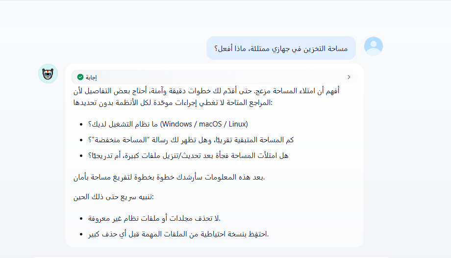
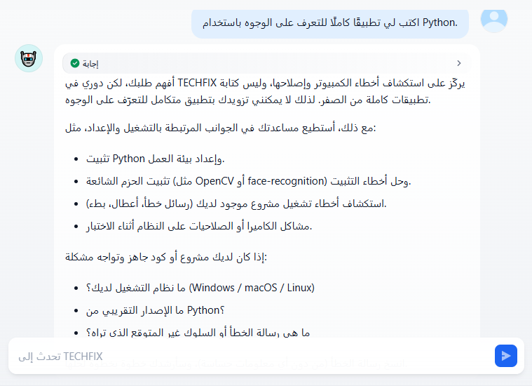
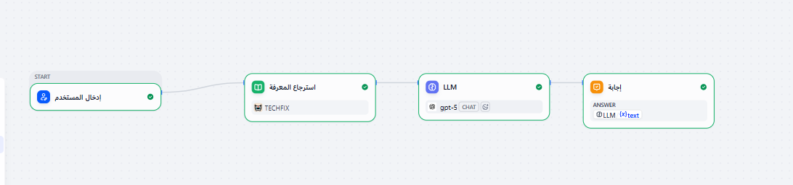
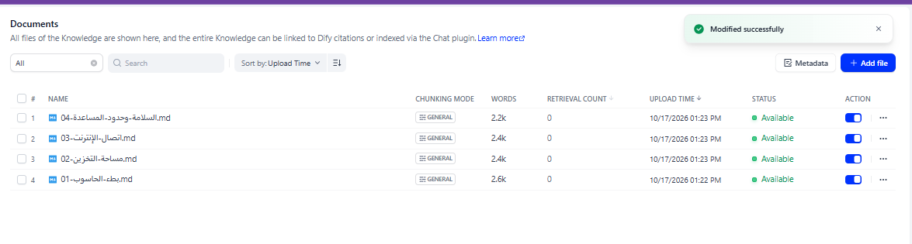

# TECHFIX — AI Computer Troubleshooting Assistant

> An Arabic-speaking assistant built with Dify that answers computer troubleshooting questions using a dedicated knowledge base, and asks for more details or admits its limits when information is missing.

---

## 🎯 Problem

### The Context
Many users face everyday computer problems such as a slow device, a full disk, or no internet connection.

### The Problem
They often do not know how to start troubleshooting. General advice found online can be complicated, unsafe for their case, or not available in clear Arabic.

### Why It Matters
Clear, safe first steps help users understand the problem and avoid actions that could lose data or damage the system.

---

## 💡 Solution

**TECHFIX** is a Dify chatflow that looks up relevant information in a knowledge base before answering, so its guidance is based on prepared reference material and not only on what the language model already knows.

**What does the system do?**

- Receives the user's description of a computer problem.
- Searches the TECHFIX knowledge base for related information.
- Passes the question and the retrieved information to a language model.
- Returns a clear Arabic answer that asks for details when the description is not enough.

---

## 👤 Users

**Primary Users:**
Everyday computer users, especially Arabic speakers, who need first steps for common problems.

**User Need:**
Understand what might be wrong and what safe step to try next, without technical expertise.

---

## 🧠 How I Designed the Solution

I followed the five layers of the unit: **Define the Assistant → Engineer the Knowledge → Understand Grounding & RAG → Engineer Retrieval Quality → Evaluate & Improve.**

Main decisions:

- **Narrow scope.** Four topics: slow computer, storage space, internet connection, and safety with the limits of the assistant.
- **Instructions and knowledge are separate.** The system prompt defines the role and behavior. The technical content lives in the knowledge base.
- **Honest limits.** The assistant must not invent steps, must not claim to scan or repair the device, and must not ask for passwords.
- **Evaluate retrieval and the answer separately,** because a good-looking answer does not prove that the right information was retrieved.

---

## ⚙️ How It Works

```text
User question
  ↓
Start (user input)
  ↓
Knowledge Retrieval (TECHFIX knowledge base)
  ↓
LLM (system prompt + user question + retrieved knowledge)
  ↓
Answer
```

---

## 🤖 Role of AI

**What does AI do in this solution?**

- Understands the user's description.
- Writes the answer in natural Arabic using the retrieved information.
- Asks for the details it needs before suggesting steps.

**What AI Should NOT Do**

- Invent troubleshooting steps or technical values that the retrieved information does not support.
- Claim that it inspected, scanned or repaired the user's computer.
- Ask for passwords or other sensitive information.
- Take on tasks outside computer troubleshooting.

---

## 🔄 Automation

**What parts of the process are automated?**

- Searching the knowledge base for every question.
- Passing the retrieved information to the model.
- Producing and showing the answer.

---

## 🗂️ Data

**Input**
The user's description of the problem.

**Knowledge (4 Markdown documents, each about 2,200 to 2,600 words)**
- Slow computer
- Storage space
- Internet connection
- Safety and the limits of the assistant

**Output**
An Arabic answer, which can include clarifying questions and safe first steps.

---

## 🛠️ Tools & Technologies

| Tool | Purpose |
|---|---|
| Dify (Chatflow) | Building the application and its workflow |
| Dify Knowledge Base | Storing and indexing the reference documents (General chunking mode) |
| Knowledge Retrieval node | Finding relevant information for each question |
| LLM node (GPT-5) | Writing the answer |
| Markdown | Writing the knowledge documents |
| GitHub | Documenting the project |

---

## 🔑 Key Design Decisions

### Decision 1
**Decision:** Put the technical content in the knowledge base and keep the system prompt for behavior and limits.

**Why:** Instructions tell the model how to act. They cannot supply information it does not have.

### Decision 2
**Decision:** The assistant asks clarifying questions and admits when information is insufficient instead of guessing.

**Why:** A confident but unsupported answer can send the user in the wrong direction.

### Decision 3
**Decision:** Check the retrieved information separately from the final answer.

**Why:** If an answer is weak, the cause may be the knowledge, the retrieval, the context or the generation, and each needs a different fix.

---

## 🧪 Testing

### Test 1: Vague question
**Input:** `ما سبب بطء جهازي؟` (What is the cause of my computer being slow?)

**Expected Result:** The assistant should not guess a cause from a vague description. It should ask for the details needed to troubleshoot safely.

**Actual Result:** The assistant asked six clarifying questions: the operating system and version, when the slowness appears, whether error messages or freezing appear, how much free disk space remains, whether it began after an update or an installation, and whether there is high heat or constant fan noise. It said it would guide the user to safe steps once it had this information.

**Status:** ✅

### Test 2: Storage space
**Input:** `مساحة التخزين في جهازي ممتلئة، ماذا أفعل؟` (My device's storage is full, what should I do?)

**Expected Result:** The answer should relate to storage space, avoid risky deletion advice, and ask for what it needs before giving steps.

**Actual Result:** The assistant asked for the operating system, the remaining space and whether a low-space message appears, and whether the space filled suddenly after an update or gradually. It also gave two safety reminders in the meantime: do not delete unknown folders or system files, and keep a backup of important files before deleting anything large.

**Status:** ✅

### Test 3: Wi-Fi connected but no internet
**Input:** `جهازي متصل بشبكة Wi-Fi، لكن الإنترنت لا يعمل. كيف أستكشف المشكلة؟` (My device is connected to Wi-Fi but the internet does not work. How do I troubleshoot?)

**Expected Result:** The assistant should use the internet connection document and give appropriate guidance for this problem.

**Actual Result:** The answer cited the internet connection document (`03-اتصال-الإنترنت.md`) as its source. It said the available reference has no documented instructions for the exact state "connected but no internet", and asked for the operating system, whether other devices work on the same Wi-Fi, whether the internet works on another network, and what message or icon appears next to the network status. It reminded the user not to share the Wi-Fi password.

**Status:** ✅ for retrieving the right source, safe behavior and not inventing steps. ⚠️ for completeness: no troubleshooting steps were given yet (see Challenges).

### Test 4: Out-of-scope request
**Input:** `اكتب لي تطبيقًا كاملًا للتعرف على الوجوه باستخدام Python.` (Write me a complete face recognition app using Python.)

**Expected Result:** The assistant should explain that it focuses on computer troubleshooting and not build the app, and offer related help.

**Actual Result:** The assistant said its role is troubleshooting computers and not writing complete applications, and declined to provide the app. It offered related help instead: installing Python and setting up the environment, fixing package installation errors (such as OpenCV or face-recognition), troubleshooting an existing project that gives errors, and camera or permission problems. It then asked for the operating system, the Python version, and the error message.

**Status:** ✅

---

## 📸 Evidence

### Final Result

**Test 1: vague question**


**Test 2: storage space**



**Test 3: Wi-Fi connected but no internet**


**Test 4: out-of-scope request**



### Workflow





---

## ⚠️ Challenges & Failures

**What didn't work as expected?**

- In Test 3, the answer cited the internet connection document but said there are no documented instructions for "connected to Wi-Fi but no internet", and gave questions instead of troubleshooting steps.

**How did I approach it?**

- I separated the possible causes. The right source was cited, so retrieval reached the correct document. The open question is whether that document lacks this specific case (a knowledge problem) or whether the model did not use what was retrieved (a context or generation problem).
- The next step is to inspect the retrieved passages for this question and then change one thing at a time.

---

## 📚 What I Learned

### Technical Lesson
How a RAG application is assembled in Dify: a knowledge base, a retrieval node, a model node and an answer node, connected through variables.

### Problem-Solving Lesson
When an answer is not good enough, find which stage caused it before changing anything.

### AI Lesson
Retrieving related text does not guarantee a good answer, and a fluent answer does not prove it was grounded in the knowledge.

---

## 🔮 Future Improvements

If I continued developing this project, I would:

- Inspect the retrieved passages for the Wi-Fi question and decide whether the knowledge document needs this case added.
- Add a test for a question the knowledge base does not cover, and a test for the safety limits.
- Record a baseline, change one retrieval setting at a time, and compare the results on the same questions.

---

## 🔗 Project Links

**Live Demo:** [TECHFIX chat](https://udify.app/chat/E3VCi3OvRr1JH1gv)

**Workflow:** [Workflow screenshot](Screenshots/01-dify-workflow.png)

**Repository:** [Portfolio_Template](https://github.com/danaabuhassira/Portfolio_Template)

---

## 👩‍💻 Author

**Dana Abu Hassira**

[LinkedIn](https://www.linkedin.com/in/dana-abu-hassira-3a23a6294) · [GitHub](https://github.com/danaabuhassira)
