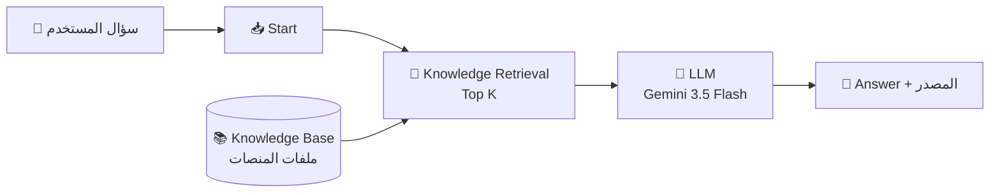

# 🧭 بوصلة الفريلانسر | Freelance Compass

### مساعد ذكي يجيب المستقل الجديد من وثائق منصات العمل الحر الرسمية، ويقول «ما عندي معلومة مؤكدة» بدل أن يخمّن

-green)

👩‍💻 **إعداد:** دانا أبوحصيرة · [GitHub: danaabuhassira](https://github.com/danaabuhassira)
📘 **المشروع:** U4 — Ground Its Knowledge

---

## 📑 المحتويات

1. [🎯 المشكلة](#-المشكلة)
2. [👥 المستخدمون](#-المستخدمون)
3. [💡 الحل المقترح](#-الحل-المقترح)
4. [📚 مصادر المعرفة](#-مصادر-المعرفة)
5. [⚙️ نظرة على النظام](#️-نظرة-على-النظام)
6. [🧠 قرارات التصميم المهمة](#-قرارات-التصميم-المهمة)
7. [🧪 الاختبار والتقييم](#-الاختبار-والتقييم)
8. [🔧 التحسينات](#-التحسينات)
9. [⚠️ القيود](#️-القيود)
10. [🚀 كيف تجرّبين التطبيق](#-كيف-تجرّبين-التطبيق)
11. [🗂️ هيكل المستودع](#️-هيكل-المستودع)

---

## 🎯 المشكلة

المستقل الجديد يتشتت بين صفحات مساعدة ووثائق متفرقة لكل منصة. يصعب عليه أن يعرف:

- 🪪 متى يُطلب منه التوثيق وماذا يحدث إن تأخر؟
- 💸 كم العمولة، ومتى تصل الأرباح، وكم الحد الأدنى للسحب؟
- ⚖️ ماذا يفعل إذا لم يدفع العميل؟
- 🚫 ما الممنوع (مثل الدفع خارج المنصة)؟

والأصعب: **الأحكام تختلف من منصة إلى أخرى**، فيخلط المستخدم بين أرقام منصة وأخرى.

> ❗ **تحدي الموثوقية:** في هذا المجال الرقم الخاطئ يكلّف المستقل مالًا أو حسابه. لذلك الأهم عندي ليس أن يجيب النظام، بل أن **يعرف من أين جاء جوابه**، وأن **يمتنع** عندما لا يجد.

---

## 👥 المستخدمون

مستقلّون ومستقلّات **جدد** يبدؤون العمل الحر على المنصات الأربع، وغالبًا يقرؤون بالعربية بينما وثائق بعض المنصات بالإنجليزية.

---

## 💡 الحل المقترح

نظام أسئلة وأجوبة (RAG) مبني على **Dify**:

- يسترجع مقاطع من وثائق المنصات **الرسمية فقط**.
- يجيب **بالاستناد إلى المقاطع** ويذكر **المصدر وتاريخ النسخ**.
- إذا لم تكفِ المقاطع يقول: **«لا أملك معلومة مؤكدة من مصدر رسمي»** ويحيل إلى مركز مساعدة المنصة.
- لا يعطي وعودًا بالدخل، ولا نصائح قانونية أو ضريبية.

---

## 📚 مصادر المعرفة

| المنصة | ما غُطّي | مستوى التغطية |
|---|---|---|
| 🟢 **Upwork** | التوثيق، Connects، الدفع والسحب، العقود، النزاعات، التحايل | قوية |
| 🟢 **Freelancer.com** | الرسوم، العروض، السحب، Milestones، التحكيم، التعامل خارج المنصة | قوية |
| 🟡 **خمسات** | العمولة، تعليق الرصيد، السحب، حالات الطلب، إضافة الخدمة | جزئية (مقتطفات رسمية) |
| 🟡 **مستقل** | العمولة، الانضمام، كتابة العرض، شروط الاستخدام | جزئية (مقتطفات رسمية) |
| ⚪ **Fiverr** | — | خارج النطاق (لا مصدر موثق في الوقت المتاح) |

### 🔍 كيف قيّمت المصادر

| الدرجة | المعنى | تدخل القاعدة؟ |
|---|---|---|
| **A** | مركز المساعدة الرسمي / الشروط والسياسات | ✅ نعم |
| **B** | صفحات رسمية أخرى على موقع المنصة (أدوات، مدونة المنصة) | ✅ نعم، مع تنبيه أن الأرقام قد تتغير |
| **C** | منتديات، مدونات طرف ثالث، فيديوهات | ❌ لا (تُستخدم فقط لاكتشاف التضارب) |

### 🛠️ مشكلات جودة المصادر التي واجهتها

- ⚠️ **تضارب في رسوم Upwork:** صفحات رسمية تعرض أرقامًا مختلفة (نظام متدرج، 10%، ونطاق 0–15%). **لم أختر رقمًا**، وسجّلته كتضارب، والمساعد يوجّه المستخدمة لرؤية نسبتها في حسابها.
- 🚧 **مواقع تحجب أدوات القراءة الآلية** (خمسات ومستقل): اعتمدت على مقتطفات رسمية، ووسمتها في الملفات بـ ◐ حتى لا تُقرأ كأنها صفحات كاملة.
- 📆 **مقالات قديمة:** مثل دليل Freelancer (2018). وُسمت بتاريخها.
- 📝 **منشورات المجتمع** تذكر أرقامًا قديمة (مثلًا حد سحب 10$ في خمسات)، فلم تُعتمد.

---

## ⚙️ نظرة على النظام

### ⚙️ إعدادات النسخة الأولى (V1)

| العنصر | القيمة |
|---|---|
| نوع التطبيق | Chatflow (Start ← Knowledge Retrieval ← LLM ← Answer) |
| الفهرسة | High Quality (Gemini Embedding) |
| Top K | **4** ← جُرّب **8** (انظري التحسينات) |
| Rerank | غير مستخدم |
| فلترة بالمنصة | غير مستخدمة في V1 (قرار مقصود، انظري أدناه) |
| نموذج الإجابة | Gemini 3.5 Flash |
| Temperature | 0.2 |

---

## 🧠 قرارات التصميم المهمة

| # | القرار | السبب |
|---|---|---|
| 1 | **ملف لكل منصة** ثم ملف مقارنة | الفلترة بالبيانات الوصفية في Dify تعمل على مستوى المستند |
| 2 | **عناوين مكتفية بنفسها:** «المنصة — المجال — الموضوع» | عند الاسترجاع قد يُفصل المقطع عن ملفه، فيجب أن يفهم العنوان وحده |
| 3 | **كلمات مفتاحية عربية** في مصادر إنجليزية | لدعم الاسترجاع بين اللغتين |
| 4 | **مصادر رسمية فقط** (A/B)، والتضارب يُسجَّل ولا يُحسم بصمت | الهدف إجابات قابلة للتحقق |
| 5 | **تلخيص بصياغتي** مع الرابط وتاريخ النسخ | حقوق النص الأصلي + إمكانية التحقق |
| 6 | **بناء V1 بدون فلترة المنصة** عمدًا | لأحصل على دليل «قبل/بعد» حقيقي |
| 7 | **Gemini عبر مفتاح مجاني** بدل كريدتس Sandbox | رصيد Sandbox لا يكفي لاختبار وإعادة اختبار |
| 8 | **Temperature منخفضة (0.2)** | إجابات أثبت وأقل ابتكارًا |

---

## 🧪 الاختبار والتقييم

**المقياس:** ✅ صحيحة ومدعومة بالمصدر · 🟡 صحيحة جزئيًا أو فيها نقص · ❌ خاطئة أو غير مدعومة

> ✍️ **ملاحظة أمانة:** هذه نتائج النسخة الأولى كما سُجلت. لم أنتظر أن تنجح كلها، فاكتشاف الخطأ وفهم سببه جزء من المشروع.

| # | الفئة | السؤال | الإجابة المتوقعة | النتيجة | الملاحظة |
|---|---|---|---|---|---|
| 1 | A (واضحة) | كيف أوثّق حسابي على Upwork؟ | خطوات التوثيق، المهلة 7 أيام، أنواع التحقق «بحسب الحالة» | 🟡 | قدّم أنواع التحقق كخطوات إلزامية بينما المصدر يقول «بحسب الحالة». خفّف نتيجة عدم التوثيق. |
| 2 | A | كم الحد الأدنى لسحب أرباح خمسات عبر PayPal؟ | 25$ | ✅ | الرقم صحيح مع تنبيه أن الأرقام قد تتغير. |
| 3 | A | كم ساعة عندي لقبول مشروع منحتني إياه Freelancer؟ | 36 ساعة | ✅ | |
| 4 | D (خاصة) | كم الحد الأدنى للسحب على Upwork؟ | 5$ للتحويل لبنك محلي حسب البلد، والباقي يظهر في الحساب | ✅ | أجاب من الملف ولم يخترع أرقام الطرق الأخرى. |
| 5 | D (بلا منصة) | كم الحد الأدنى للسحب؟ | أرقام كل منصة مع تسميتها | 🟡 | **Upwork غابت** من الجواب رغم أنها في القاعدة. تكرر في أكثر من تجربة. |
| 6 | B (موزعة) | العميل يريد واتساب ودفعًا خارجيًا، ماذا أفعل؟ | ممنوع، وعواقبه تختلف حسب المنصة | 🟡 | Upwork وخمسات صحيحتان. **مستقل غابت.** في إحدى المرات نقل غرامة Freelancer (3,000$) دون التحفظ الوارد في المصدر. |
| 7 | C (غير موجودة) | كيف أوثّق حسابي على خمسات؟ | لا معلومة مؤكدة (غير مغطى)، ويحيل لمركز المساعدة | ✅ | رفض بأمانة وأحال لروابط موجودة فعلًا في الملف. |

### 🔎 نتائج الاسترجاع (قبل نموذج الإجابة)

| الاختبار | السؤال | ما حدث |
|---|---|---|
| **R-1** | «كم الحد الأدنى للسحب؟» (بلا منصة) | رجعت مقاطع من خمسات وFreelancer ومستقل. **Upwork غائبة تمامًا.** الدرجات متقاربة (0.71–0.77) فلا مقطع يتفوق بوضوح. |
| **R-2** | «كيف أوثّق حسابي على Upwork؟» | الأربعة كلها من `upwork.md` وعن التوثيق (0.74–0.80). **عندما تُذكر المنصة يعمل الاسترجاع جيدًا.** |

> 💡 **الاستنتاج المبدئي:** الاسترجاع قوي عندما يُذكر اسم المنصة، ويضعف في الأسئلة التي تخص أكثر من منصة أو لا تذكر منصة.

### 📸 الأدلة

| الدليل | اسم الملف المقترح في `screenshots/` | الحالة |
|---|---|---|
| لقطة الـ Chatflow | `01-chatflow.png` | ⏳ |
| لقطة إعدادات الفهرسة والتقسيم | `02-indexing-settings.png` | ⏳ |
| المقاطع المسترجعة قبل التحسين (Top K = 4) | `03-retrieval-before.png` | ⏳ |
| المقاطع المسترجعة بعد التحسين (Top K = 8) | `04-retrieval-after.png` | ⏳ |
| جواب صحيح | `05-correct-answer.png` | ⏳ |
| جواب كشف مشكلة | `06-problem-answer.png` | ⏳ |

---

## 🔧 التحسينات

### 🐞 المشكلة الرئيسية: منصة تغيب عن الجواب

| العنصر | التفصيل |
|---|---|
| **الخطأ** | في الأسئلة التي تخص أكثر من منصة، تغيب منصة كاملة (Upwork في «الحد الأدنى للسحب»، ومستقل في «الدفع خارج المنصة») رغم وجود معلومتها في القاعدة. |
| **السبب المحتمل** | لا فلترة بالمنصة، وTop K = 4: مقاطع منصة واحدة (Freelancer) تزاحم غيرها. هذا **استنتاج من النمط**، والتأكيد يكون بفحص المقاطع المسترجعة. |
| **المرحلة المسؤولة** | الاسترجاع (وجزئيًا توليد الإجابة في حالة إسقاط التحفظ). |

### 🧪 التجارب

| التجربة | التغيير | النتيجة |
|---|---|---|
| **1** | رفع **Top K من 4 إلى 8** | ⏳ تحسّن جزئي: في اختبار الدفع خارج المنصة لم يُنقل بند Freelancer الملتبس. **مستقل ما زالت غائبة.** (تعدد المتغيرات وتذبذب النموذج يمنع اعتبارها إثباتًا قاطعًا.) |
| **2** | إضافة قسم مخصص لـ«مستقل: الدفع والتواصل خارج الموقع» وقسم «Upwork: الحد الأدنى للسحب» بعنوان يطابق صيغة السؤال | ⏳ قيد التنفيذ |
| **3** | قاعدة في البرومبت: «إذا حمل المصدر تحفظًا فاذكره ولا تحذفه» | ⏳ قيد التنفيذ |
| **4** (اختياري) | فلترة الاسترجاع بالمنصة | ⏳ إذا لم تكفِ التجارب السابقة |

> 📌 ⏳ = **املئي الخانة بالنتيجة الفعلية بعد إعادة الاختبار، ولا تكتبي نجاحًا لم تشاهديه.**

### 📚 ما تعلمته

- وجود المعلومة في القاعدة **لا** يعني أنها ستُسترجع.
- الجواب الذي «يبدو منطقيًا» ليس دليلًا على أنه مدعوم بالمصدر.
- تضارب المصادر الرسمية نفسها يجب أن **يُوثَّق** لا أن يُخفى بالتخمين.

---

## ⚠️ القيود

- 🚫 **Fiverr غير مغطاة.**
- 🟡 **خمسات ومستقل** من مقتطفات رسمية لأن موقعيهما يحجبان القراءة الآلية؛ بعض المجالات لم تُقرأ (توثيق خمسات، نزاعاتها، مدة تعليق مستقل وحد السحب فيه).
- ⚖️ **رسوم Upwork** غير محسومة لأن المصادر الرسمية نفسها تتضارب.
- 🔄 **الأرقام تتغير:** كل جواب يحمل تاريخ النسخ، ويُنصح بمراجعة الصفحة الحية.
- 🌍 **توفر السحب البنكي في فلسطين** غير مؤكد من مصدر رسمي.
- ⚡ **قيود الأداة:** ظهر خطأ `503` من نموذج Gemini أثناء ضغط الطلب، وأحيانًا تنقطع جملة النهاية في الجواب (قد يلزم رفع Max Tokens).
- 🙅‍♀️ **لا نصائح قانونية أو ضريبية** ولا وعود بدخل.

---

## 🚀 كيف تجرّبين التطبيق

1. 🔗 افتحي رابط التطبيق: **⏳ [ضعي رابط Dify هنا]**
2. ✍️ اسألي بالعربية، مثل:
   - `كم الحد الأدنى لسحب أرباح خمسات عبر PayPal؟`
   - `كم ساعة عندي لقبول مشروع منحتني إياه Freelancer؟`
   - `كيف أوثّق حسابي على Upwork؟`
3. 🧪 جرّبي **سؤالًا لا إجابة له في القاعدة** لترين كيف يرفض بأمانة، مثل:
   - `كيف أوثّق حسابي على خمسات؟`
   - `كم سأربح شهريًا على Upwork؟`
4. 🔍 انظري إلى **المصدر وتاريخ النسخ** تحت كل جواب.

> 🔒 لا يحتوي المستودع على مفاتيح API أو بيانات خاصة.

---

### 🧭 «الهدف ليس أن يجيب الذكاء الاصطناعي، بل أن نفهم كيف يجيب ونحسّن ذلك.»

