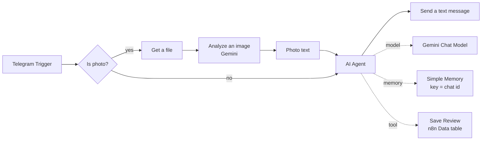
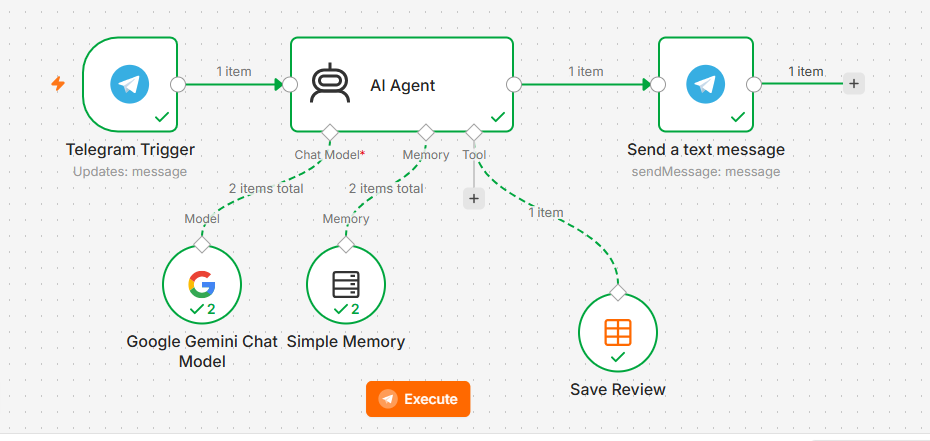
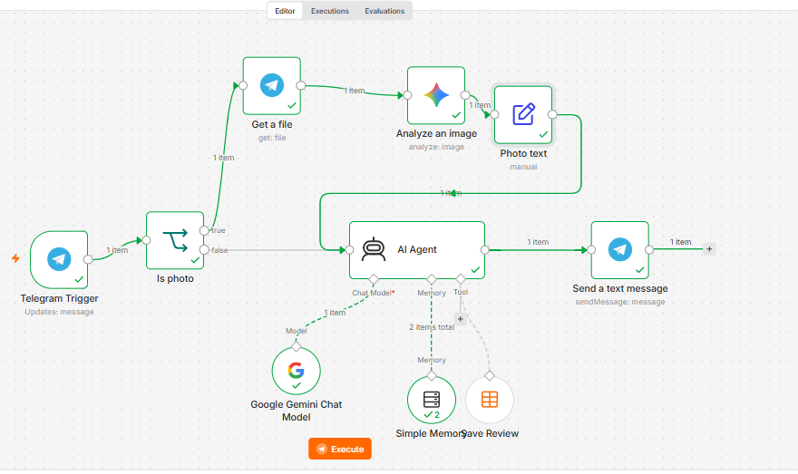
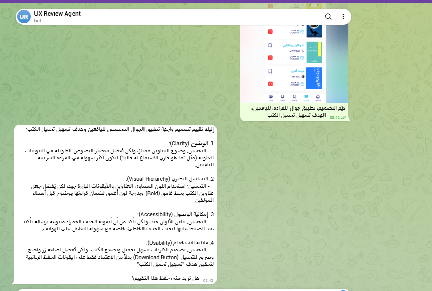

# UX Review Agent

An AI Agent built with **n8n**, **Telegram** and **Google Gemini** that reviews UX/UI design briefs and design screenshots, asks for missing information, saves reviews only with the user's consent, and stops and escalates to a human when asked to do something it is not allowed to do.

**Author:** Dana Abuhassira (U5 Project: Control Its Agency)

---

## Problem
UX/UI designers (students and freelancers) often start from incomplete briefs and need quick, structured feedback before delivering work to a client or instructor. Getting that feedback takes time, and a generic chatbot tends to give generic answers without checking the context first.

## Target Users
UX/UI designers: students and freelancers who want a fast first review of a design idea or screen.

## Agent Goal
Review a design brief or screenshot through Telegram and return structured feedback on **clarity, visual hierarchy, accessibility and usability**, with one concrete improvement per area, and save the review to a table when the user agrees.

## Why an Agent (and not a chatbot)?
A chatbot answers every message the same way. This agent **decides** what to do for each case:

| Situation | Decision |
|---|---|
| Platform, users and goal are all given | Review, then ask whether to save |
| Something is missing or the request is vague | Ask only for the missing items, do not guess |
| The request is not about UX/UI (e.g. code) | Refuse politely and explain its role |
| The user says yes to saving | Use the Save Review tool |
| The user asks to delete or edit saved data | Refuse immediately, a human must do it |
| The user sends a design image | Describe it with Gemini, then review the description |

## How It Works

## Tools
- **Telegram**: input and output channel.
- **Google Gemini (chat model)**: reasoning and the review itself.
- **Google Gemini (Analyze an image)**: turns a design screenshot into a text description.
- **Simple Memory**: keeps the conversation context per chat.
- **Save Review**: n8n Data table tool, **insert only**, columns `platform`, `users`, `goal`, `summary`.

## Autonomy Boundaries
- **Acts alone:** reviews a design when it has platform, users and goal; asks clarifying questions.
- **Asks first:** missing information; saving a review (only after a clear yes).
- **Never:** deletes or edits saved data (it has no such tool), handles non-UX requests, claims it did something it cannot do.
- **Escalates:** delete or edit requests go to a human, who does it manually in the reviews table.

See [docs/agent-design.md](docs/agent-design.md) for the full design and the final System Prompt.

## Evaluation
8 test scenarios were run, covering normal cases, missing information, vague requests, out-of-scope requests, escalation, and image input. One behaviour problem was found in the escalation case and fixed, and a second bug was found and fixed while adding the image branch.

See [docs/evaluation-results.md](docs/evaluation-results.md).

## Evidence
| Workflow (text version) | Workflow with image branch |
|---|---|
|  |  |

**Image review on Telegram** (screenshot of a mobile reading app, sent with a short note):

More screenshots are in the [evidence](evidence/) folder.

## How to Run
1. Import `workflow/ux-review-agent.json` into n8n.
2. Create a Telegram bot with BotFather and add its token as a Telegram credential.
3. Add your own Google Gemini API key as a credential.
4. Create an n8n Data table named `reviews` with the columns `platform`, `users`, `goal`, `summary`.
5. Select the credentials on each node, then **Publish** the workflow.
6. Message the bot on Telegram.

No tokens or API keys are included in this repository.

## Limitations and Future Work
- For images, the agent reviews **Gemini's text description** of the screenshot, not the pixels themselves, so details Gemini does not mention will not appear in the review.
- Tested on the Gemini free tier, which has a daily request quota per model; heavy testing can hit a 429 error.
- Save Review is insert only by design. An approval step (Telegram buttons) for human-confirmed deletion could be added later.
