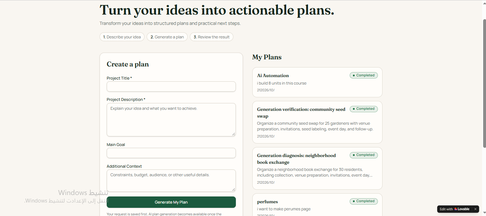
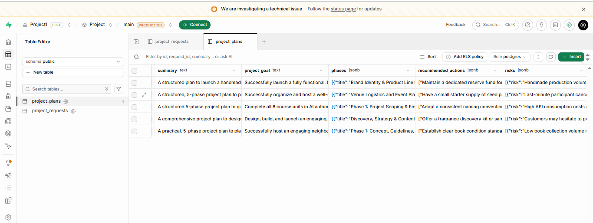
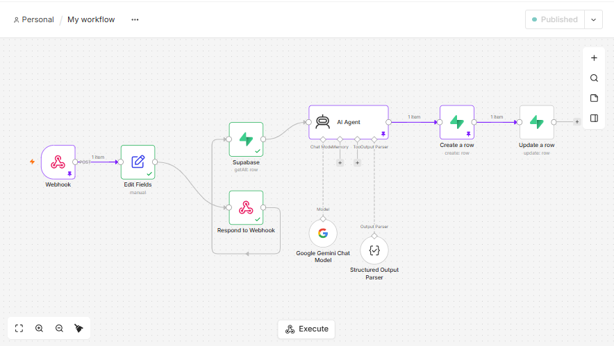
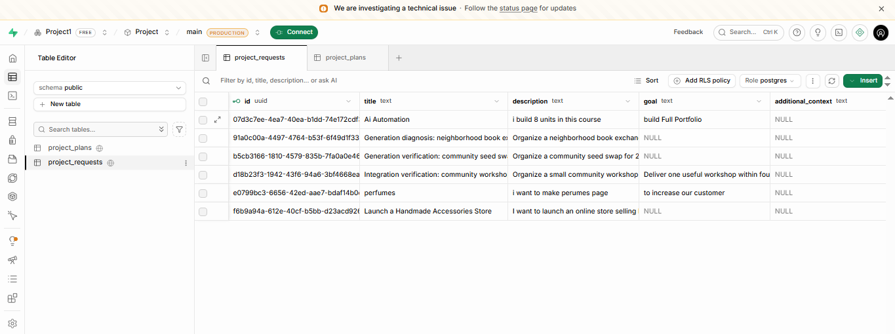

# PlanCraft AI

> A web app that turns a project idea into a structured action plan by connecting a Lovable interface, a Supabase database and an n8n workflow with an AI agent.

---

## 🎯 Problem

### The Context
People often start with an idea for a project, but not with a plan.

### The Problem
It is hard to turn an idea into clear steps: what the real goal is, which phases are needed, what actions to take, what risks to expect, and what to do first.

### Why It Matters
A structured plan makes the idea easier to review and to start working on, instead of staying a general answer in a chat.

---

## 💡 Solution

**PlanCraft AI** lets a user enter project details in a web app. The app saves the request, sends it to an automated workflow that generates a structured plan with an AI agent, saves the plan, and shows the result to the user.

**What does the system do?**

- Takes a project title, description, main goal and additional context from the user.
- Saves the request in a database.
- Triggers an n8n workflow through a webhook.
- Generates a structured plan with an AI agent.
- Saves the plan and updates the request status.
- Shows the user their plans with a status.

---

## 👤 Users

**Primary Users:**
Students, freelancers and early-career professionals with a project idea.

**User Need:**
Turn a rough idea into an organized plan they can review and act on.

---

## 🧠 How I Designed the Solution

I designed this as an **integration** between three separate systems, each with one responsibility:

| System | Responsibility |
|---|---|
| **Lovable** | The interface: collecting the request, showing status and the result |
| **Supabase** | The data: storing requests and generated plans |
| **n8n Cloud** | The automation: reading the request, running the AI agent, saving the result |

Main decisions:

- **Save first, then process.** The request is stored before the workflow starts.
- **Separate tables** for requests and for plans.
- **A status on each request** so the interface can tell when the plan is ready.
- **Structured output from the AI,** so the plan can be saved in separate fields.

---

## ⚙️ How It Works

```text
User fills in the form (Lovable)
  ↓
Request saved in Supabase: project_requests
  ↓
Lovable calls the n8n Webhook (POST)
  ↓
Edit Fields
  ├─ Supabase: get the request
  └─ Respond to Webhook (early HTTP response)
  ↓
AI Agent (Google Gemini + Structured Output Parser)
  ↓
Supabase: create a row in project_plans
  ↓
Supabase: update the request status
  ↓
Lovable shows the saved plan with its status
```

---

## 🤖 Role of AI

**What does AI do in this solution?**

- Reads the project request.
- Generates a plan with a summary, a project goal, phases, recommended actions and risks.
- Returns the plan as structured data through the output parser.

**What AI Should NOT Do**

- Promise that the project will succeed. The plan is a suggestion for the user to review.

---

## 🔄 Automation

**What parts of the process are automated?**

- Starting the workflow from the app through a webhook.
- Reading the request from the database.
- Generating the plan.
- Saving the plan and updating the request status.

---

## 🗂️ Data

**Input**
Project title, project description, main goal and additional context (`project_requests`).

**Output**
A plan with `summary`, `project_goal`, `phases`, `recommended_actions` and `risks`, where the last three are stored as JSON (`project_plans`).

---

## 🛠️ Tools & Technologies

| Tool | Purpose |
|---|---|
| Lovable | Building the web application |
| Supabase (PostgreSQL) | Storing requests and plans |
| n8n Cloud | Orchestrating the workflow |
| Webhook (HTTP POST) | Sending the request from the app to n8n |
| Google Gemini | The language model behind the AI agent |
| Structured Output Parser | Getting the plan as structured JSON |
| GitHub | Documenting the project |

---

## 🔑 Key Design Decisions

### Decision 1
**Decision:** Respond to the webhook early, and continue the processing afterwards.

**Why:** Accepting a request is not the same as completing the work. The request status shows when the plan is finished.

### Decision 2
**Decision:** Keep requests and plans in two tables.

**Why:** Each table has one clear purpose, and a plan is linked to the request it came from.

### Decision 3
**Decision:** Use a structured output parser for the AI agent.

**Why:** A plan returned as structured fields can be saved in the database and displayed reliably.

---

## 🧪 Testing

### Test 1: Saving a request
**Input:** Enter a project title, description and main goal in the app and submit.

**Expected Result:** The request is saved in the `project_requests` table.

**Actual Result:** The table holds the submitted requests with their title, description and goal.

**Status:** ✅

### Test 2: Generating and saving a plan
**Input:** A saved request triggers the workflow.

**Expected Result:** The AI agent generates a structured plan, and it is saved in `project_plans`.

**Actual Result:** The `project_plans` table holds generated plans with a summary, a project goal, and JSON fields for phases, recommended actions and risks.

**Status:** ✅

### Test 3: Status shown to the user
**Input:** Open the app after the workflow has run.

**Expected Result:** The user's plans appear in **My Plans** with a status.

**Actual Result:** The plans are listed in My Plans with the **Completed** status.

**Status:** ✅

---

## 📸 Evidence

### Final Result





### Workflow





---

## 📚 What I Learned

### Technical Lesson
How an application, a database and an automation tool exchange data through a webhook and shared tables, and how each step depends on the one before it.

### Problem-Solving Lesson
Check each stage separately: the saved request, the workflow run, the saved plan, and the status shown in the app.

### AI Lesson
An AI agent is more useful inside a system when its output is structured and saved, not only shown in a chat.

---

## 🔮 Future Improvements

If I continued developing this project, I would:

- Let users edit a plan or generate it again.
- Add an estimated duration for each phase.
- Add an export option for the finished plan.

---

## 🔗 Project Links

**Live Demo:** [PlanCraft AI](https://screenshot-to-spark-423.lovable.app/)

**Workflow:** [n8n workflow screenshot](Screenshots/02-n8n-workflow.png)

**Repository:** [Portfolio_Template](https://github.com/danaabuhassira/Portfolio_Template)

---

## 👩‍💻 Author

**Dana Abu Hassira**

[LinkedIn](https://www.linkedin.com/in/dana-abu-hassira-3a23a6294) · [GitHub](https://github.com/danaabuhassira)
