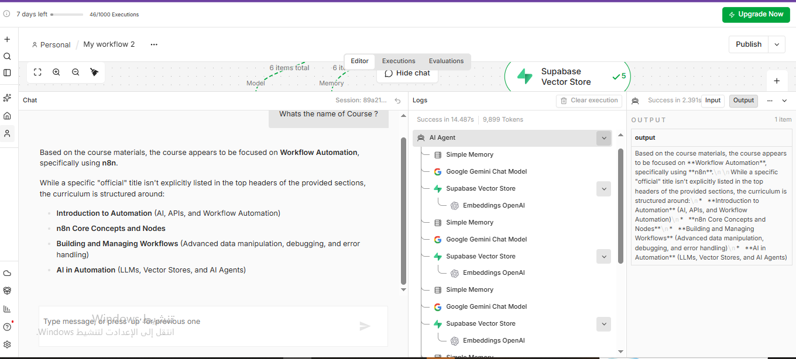
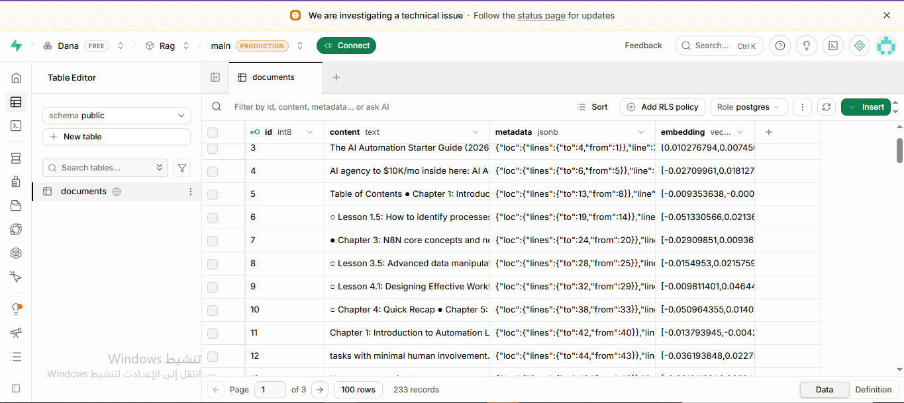
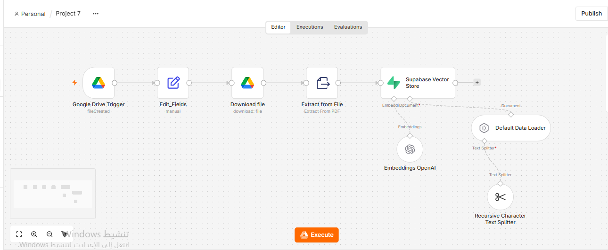
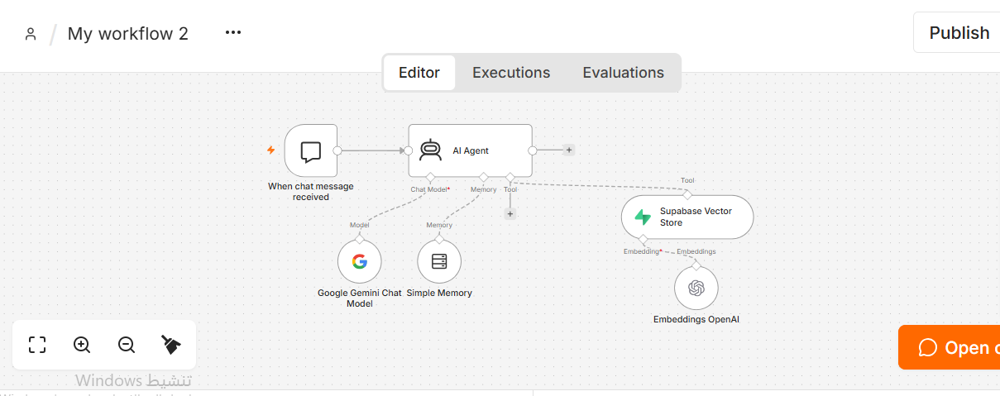
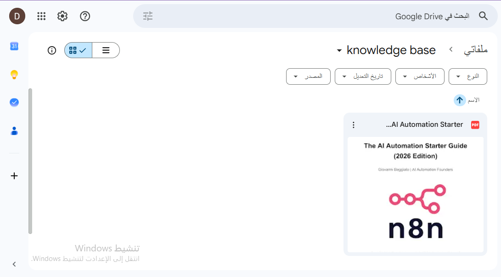
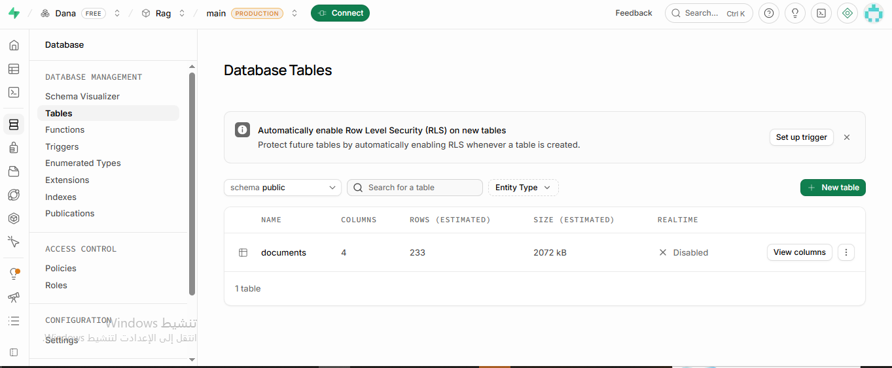

# RAG with n8n — Knowledge Pipeline & RAG AI Agent

> A two-part system built with n8n and Supabase: a pipeline that turns a PDF into searchable knowledge, and an AI agent that answers questions by searching that knowledge.

---

## 🎯 Problem

### The Context
A language model does not automatically know the content of a specific document. Answers about a particular guide, policy or course need to come from that material.

### The Problem
Pasting documents into a chat does not scale, and a model answering from general knowledge can sound convincing without being based on the document.

### Why It Matters
When answers must come from specific material, the system needs a way to find the relevant parts of the document and use them when answering.

---

## 💡 Solution

A **Retrieval-Augmented Generation (RAG)** system in two parts:

1. **Knowledge pipeline:** takes a PDF from Google Drive, extracts its text, splits it into chunks, turns the chunks into embeddings, and stores them in a Supabase vector store.
2. **RAG AI agent:** receives a question in a chat, searches the vector store through a tool, and writes the answer from the retrieved content.

**What does the system do?**

- Watches a Google Drive folder for new files.
- Processes a PDF into searchable knowledge stored in Supabase.
- Answers questions in a chat by retrieving relevant chunks.
- Keeps the conversation context with a memory node.

---

## 👤 Users

**Primary Users:**
Anyone who needs answers from a specific document, such as learners using a course guide.

**User Need:**
Ask a question in plain language and get an answer based on the material, without reading the whole document.

---

## 🧠 How I Designed the Solution

The main design idea is to separate two jobs:

- **Preparing knowledge** (ingestion): done once per document, ahead of any question.
- **Using knowledge** (retrieval and answering): done for every question.

Other decisions:

- **Knowledge and memory are different.** The vector store holds what the document says. The memory node holds what was said in the conversation.
- **Embeddings are used twice:** for the document chunks when storing them, and for the question when searching.
- **The vector store is a tool for the agent,** so the agent decides when it needs to search.

---

## ⚙️ How It Works

**Part 1: Knowledge pipeline**

```text
Google Drive Trigger (file created)
  ↓
Edit Fields (file id)
  ↓
Download file
  ↓
Extract from File (PDF)
  ↓
Supabase Vector Store (insert)
   ├─ Default Data Loader
   │    └─ Recursive Character Text Splitter
   └─ Embeddings (OpenAI)
```

**Part 2: RAG agent**

```text
When chat message received
  ↓
AI Agent
   ├─ Google Gemini Chat Model
   ├─ Simple Memory
   └─ Supabase Vector Store (tool)
        └─ Embeddings (OpenAI)
  ↓
Answer
```

---

## 🤖 Role of AI

**What does AI do in this solution?**

- Embeddings turn text into numeric vectors so that search works by meaning.
- The language model (Gemini) understands the question, decides to use the search tool, reads the retrieved chunks and writes the answer.

**What AI Should NOT Do**

- Invent information that is not in the retrieved material. The vector store holds the knowledge, not the model.

---

## 🔄 Automation

**What parts of the process are automated?**

- Starting the pipeline when a file is added to the Drive folder.
- Extracting, splitting, embedding and storing the document.
- Searching the knowledge for each question.

---

## 🗂️ Data

**Input**
A PDF in a Google Drive folder, and user questions in the chat.

**Knowledge source**
*The AI Automation Starter Guide (2026 Edition)*, a third-party PDF used as the knowledge source. The PDF itself is not included in this repository.

**Stored data (`documents` table in Supabase)**
`id`, `content` (the chunk text), `metadata` (JSON with location information) and `embedding` (the vector).

**Output**
An answer written from the retrieved chunks.

---

## 🛠️ Tools & Technologies

| Tool | Purpose |
|---|---|
| n8n Cloud | Building the pipeline and the agent |
| Google Drive | Source of the document |
| Supabase (PostgreSQL + vector support) | Storing chunks and embeddings and searching them |
| OpenAI Embeddings | Turning chunks and questions into vectors |
| Google Gemini | The chat model behind the agent |
| GitHub | Documenting the project |

---

## 🔑 Key Design Decisions

### Decision 1
**Decision:** Build ingestion and answering as two separate workflows.

**Why:** Preparing knowledge and answering questions are different jobs. Keeping them apart makes each one easier to run and to check.

### Decision 2
**Decision:** Give the agent the vector store as a tool.

**Why:** The agent searches when a question needs the document, instead of searching blindly for every message.

### Decision 3
**Decision:** Use the same embedding approach for documents and for questions.

**Why:** A question vector can only be compared fairly with document vectors made the same way.

---

## 🧪 Testing

### Test 1: Knowledge ingestion
**Input:** Add the PDF to the Google Drive folder.

**Expected Result:** The pipeline processes the file and stores its chunks, with embeddings, in Supabase.

**Actual Result:** The `documents` table holds 233 records, and the stored `content` shows passages from the guide (such as its table of contents and chapters).

**Status:** ✅

### Test 2: The agent searches the knowledge
**Input:** Ask the agent a question in the chat.

**Expected Result:** The agent uses the vector store tool before answering.

**Actual Result:** The execution logs show the agent calling the Supabase Vector Store tool, with OpenAI embeddings, together with the memory node and the Gemini model.

**Status:** ✅

### Test 3: Question about the course material
**Input:** `Whats the name of Course ?`

**Expected Result:** An answer based on the retrieved material, without making up a title.

**Actual Result:** The agent answered from the course materials: it said the course focuses on workflow automation with n8n, noted that no official title was explicitly listed in the retrieved sections, and summarized the topics it found (introduction to automation, n8n core concepts and nodes, building and managing workflows, and AI in automation).

**Status:** ✅

---

## 📸 Evidence

### Final Result





### Workflow









---

## 📚 What I Learned

### Technical Lesson
How a RAG system is built from separate parts: extraction, chunking, embeddings, a vector store, a retrieval tool and a model.

### Problem-Solving Lesson
When an answer is wrong, find the stage first: was the document stored, was the right chunk retrieved, or did the model use it badly?

### AI Lesson
RAG is an architecture, not a single node. Retrieval finds the information and the model writes the answer, and each needs its own checking.

---

## 🔮 Future Improvements

If I continued developing this project, I would:

- Add more documents to the knowledge base.
- Compare different chunk sizes and numbers of retrieved chunks, changing one setting at a time.
- Store the file name in the chunk metadata so answers can point to their source.

---

## 🔗 Project Links

**Workflow:** [Knowledge pipeline screenshot](Screenshots/01-ingestion-workflow.png) · [RAG agent screenshot](Screenshots/02-rag-agent-workflow.png)

**Repository:** [Portfolio_Template](https://github.com/danaabuhassira/Portfolio_Template)

---

## 👩‍💻 Author

**Dana Abu Hassira**

[LinkedIn](https://www.linkedin.com/in/dana-abu-hassira-3a23a6294) · [GitHub](https://github.com/danaabuhassira)
